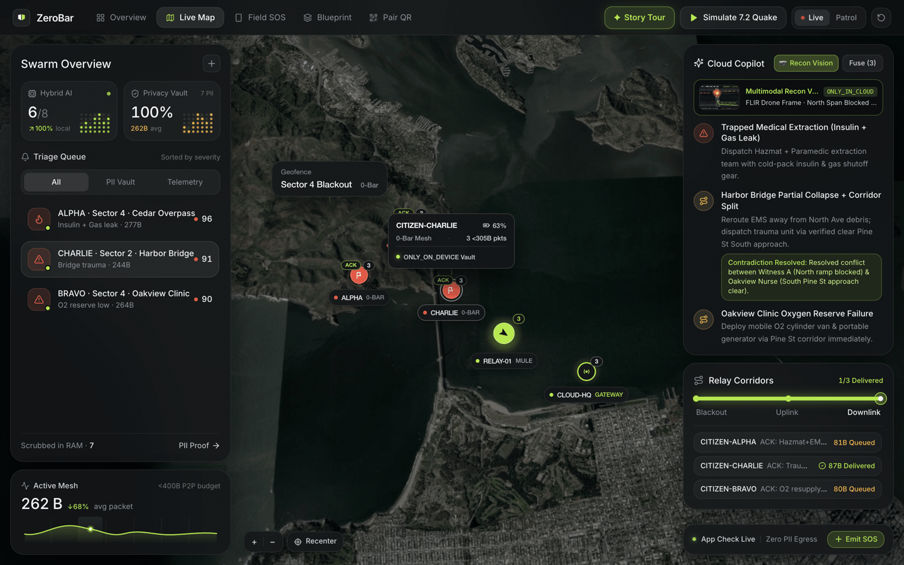
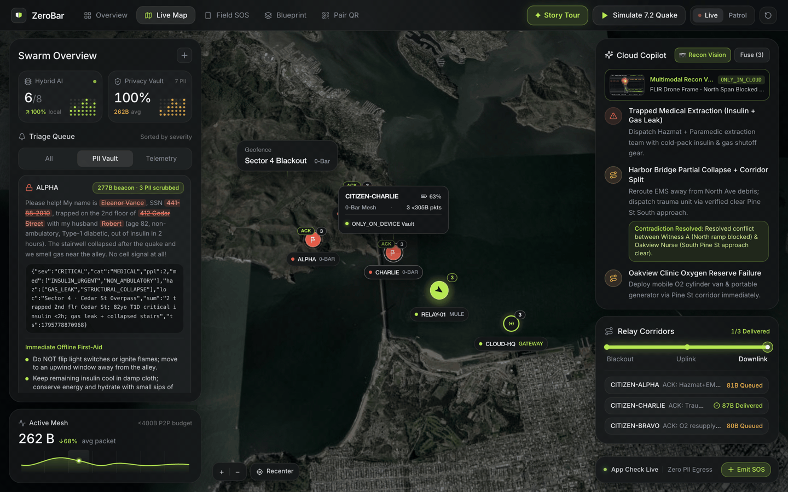
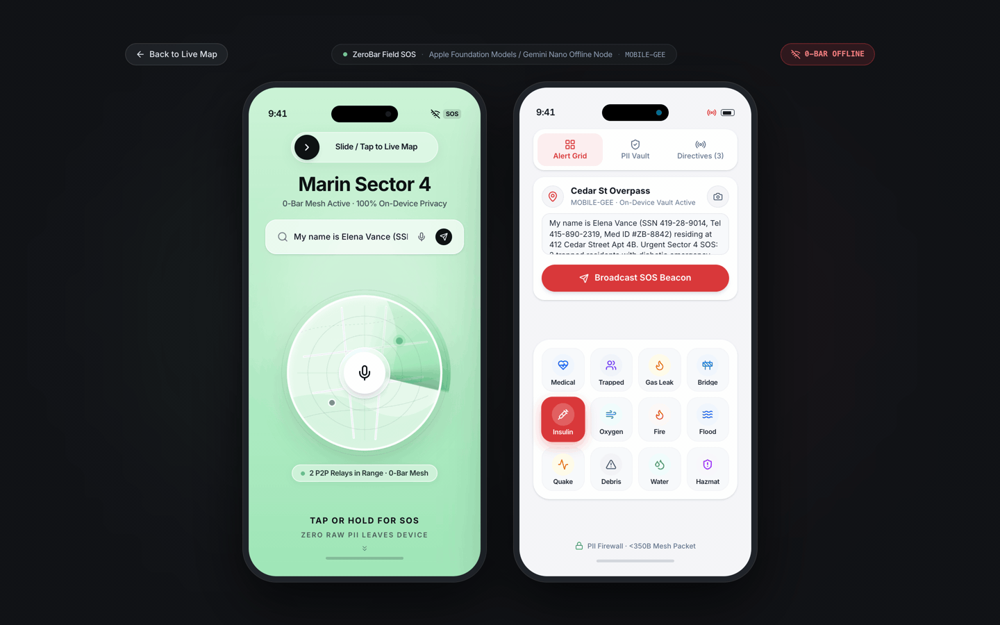
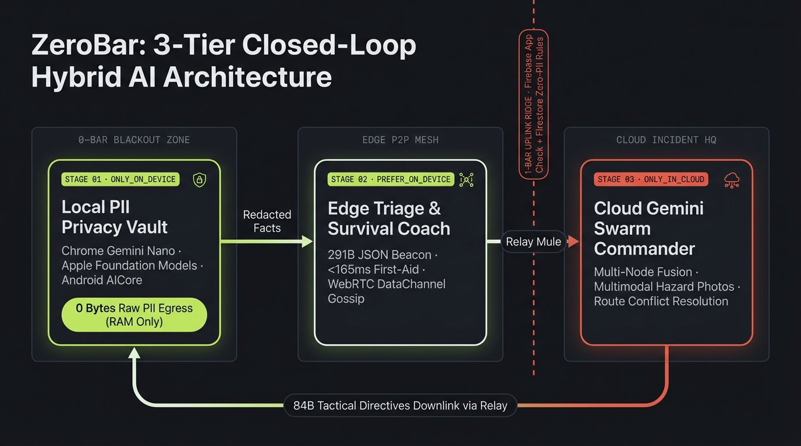

# ZeroBar: Off-Grid Crisis Swarm & Hybrid AI Incident Commander

> Built for the **#BuildHybridAI 2026 Hackathon** across **all 3 official tracks (Web/Chrome · iOS · Android)**, powered by **Firebase AI Logic Hybrid Inference**, **Firebase App Check**, and **Firestore Offline Persistence**.

[](https://zerobar-hybrid-ai-2026.web.app)
[](https://zerobar-hybrid-ai-2026.web.app/?mode=mobile&room=CASCADIA-01)
[](#multi-platform-architecture-all-3-buildhybridai-tracks)
[](./LICENSE)

- **Live Firebase Hosting Demo:** [https://zerobar-hybrid-ai-2026.web.app](https://zerobar-hybrid-ai-2026.web.app)
- **Direct Mobile Field SOS URL:** [https://zerobar-hybrid-ai-2026.web.app/?mode=mobile&room=CASCADIA-01](https://zerobar-hybrid-ai-2026.web.app/?mode=mobile&room=CASCADIA-01)
- **Public GitHub Repo (MIT):** [https://github.com/samadon1/zerobar](https://github.com/samadon1/zerobar)
- **Firebase Project ID:** `zerobar-hybrid-ai-2026`

<p align="center">
  <a href="https://zerobar-hybrid-ai-2026.web.app">
    
  </a>
</p>

## Visual Showcase: Privacy Proof & Field SOS

| On-Device PII Redaction Vault (`ONLY_ON_DEVICE`) | Dual-Mode Field SOS (`0-Bar Offline` Radar & Alert Grid) |
| :---: | :---: |
|  |  |
| Names, SSNs, phone numbers, and street numbers are struck through locally in RAM (`277B beacon · 3 PII scrubbed`, `262B avg`). `rawInputLocalOnly` mathematically never leaves the origin device. | Tactile 0-Bar voice radar + 12-tile crisis composer (`Trapped`, `Gas Leak`, `Insulin`) delivering instant ~150ms offline first-aid steps and `<400B` P2P beacons. |

---

## 60-Second Judge Verification Guide

1. **Launch the Live Spatial Command Center & FLIR Recon Vision (15s):** Open [https://zerobar-hybrid-ai-2026.web.app](https://zerobar-hybrid-ai-2026.web.app) and click **`Story Tour`** (or **`Simulate 7.2 Quake`**), then click **`Recon Vision`** inside **Cloud Copilot** to attach a tactical FLIR drone hazard frame (`InlineDataPart`) to `CITIZEN-CHARLIE` and fuse multi-node beacons via `InferenceMode.ONLY_IN_CLOUD` (resolving the Harbor Bridge North vs. Pine St South contradiction into `<100B` ACKs).
2. **Verify the `PII Vault` Redaction Proof (10s):** Click the **`PII Vault`** tab in the left *Triage Queue* panel to inspect struck-through names, SSNs, and street addresses paired directly with the `<270B` clinical JSON packet, backed by [`firestore.rules`](./firestore.rules) (hard-rejects `rawInputLocalOnly`, SSN patterns, and payloads `> 2048B`).
3. **Run the 1-Click Live Firestore Zero-PII Penetration Test (10s):** Click **`Blueprint -> Test Live DB Firewall`** to fire an unredacted adversary SSN write (`BLOCKED · PERMISSION_DENIED`) alongside a sanitized `<300B` `CompactBeaconPayload` probe (`ACCEPTED · 200 OK`) directly against deployed Firestore rules.
4. **Model 50,000-Citizen Disaster Surge Economics (10s):** Click **`Overview`** in the top bar and drag the interactive surge slider up to `50,000` blackout citizens to inspect `$0` local NPU triage turns (`2.5M`), `99.0%` cloud API quota reduction via 20:1 Relay Mule batching, `98.4%` mesh bandwidth saved (`885.5 MB`), and `0 Bytes` raw PII egress.
5. **Test Field SOS & All 3 Official `#BuildHybridAI` Platforms (15s):** Click **`Field SOS`** in the top bar (or open [the Mobile Field URL](https://zerobar-hybrid-ai-2026.web.app/?mode=mobile&room=CASCADIA-01) via **`Pair QR`**) to test offline radar + 12-tile SOS broadcast, and inspect all 3 native/web implementations in one repo:
   - **Web / Chrome (`src/`):** [`src/services/firebase.ts`](./src/services/firebase.ts) + [`src/services/hybridEngine.ts`](./src/services/hybridEngine.ts) + [`src/components/SwarmMapCanvas.tsx`](./src/components/SwarmMapCanvas.tsx) (React 19, MapLibre GL, Chrome Gemini Nano, WebRTC P2P).
   - **iOS (`ios/ZeroBarField/`):** [`HybridAIEngine.swift`](./ios/ZeroBarField/Services/HybridAIEngine.swift) + [`MeshModels.swift`](./ios/ZeroBarField/Models/MeshModels.swift) (SwiftUI, Apple Foundation Models, `AppAttest`).
   - **Android (`android/ZeroBarField/`):** [`HybridAIEngine.kt`](./android/ZeroBarField/app/src/main/java/app/zerobar/field/services/HybridAIEngine.kt) + [`MeshModels.kt`](./android/ZeroBarField/app/src/main/java/app/zerobar/field/models/MeshModels.kt) (Jetpack Compose, Kotlin, AICore Gemini Nano, `PlayIntegrity`).

---

## The Problem

During earthquakes, wildfires, and grid blackouts, **up to 90% of trapped citizens have zero cellular bars**, while only intermittent responder vehicles or ridge relays briefly catch 1 bar of signal.

- **Cloud-only AI fails completely** in the blackout zone, and forcing desperate citizens to broadcast raw distress messages over untrusted peer-to-peer relays leaks sensitive personal/medical data (full names, SSNs, exact home addresses, medical IDs).
- **On-device-only AI cannot see the whole city**: a single offline phone cannot deduplicate overlapping casualties across neighborhoods, resolve conflicting bridge/corridor closure reports, or fuse multi-photo hazard evidence.

---

## How ZeroBar Uses Firebase AI Logic Hybrid Inference

<p align="center">
  
</p>

ZeroBar assigns **three distinct `InferenceMode` configurations** across Web (`src/services/firebase.ts`), iOS (`ios/ZeroBarField/Services/HybridAIEngine.swift`), and Android (`android/ZeroBarField/.../HybridAIEngine.kt`), inspecting real `response.inferenceSource` telemetry (`ON_DEVICE` vs `IN_CLOUD`) on every call:

| Stage | Firebase AI Logic Mode | Why This Mode Is Essential |
| :--- | :--- | :--- |
| **1. PII Privacy Vault** | `InferenceMode.ONLY_ON_DEVICE` | Strictly scrubs names, SSNs, phone numbers, exact house numbers, and medical IDs locally on-device (Chrome Gemini Nano / Apple Foundation Models / Android AICore). Raw PII (`rawInputLocalOnly`) mathematically never leaves the citizen's device. |
| **2. Edge Triage & Survival Coach** | `InferenceMode.PREFER_ON_DEVICE` | Compresses panicked multi-sentence voice/text (any language) into a **`<400-byte` structured JSON Triage Beacon** (88% to 99.2% byte reduction for P2P mesh gossip) and gives 3 immediate offline first-aid steps in ~150ms. Falls back seamlessly to Cloud Gemini (`gemini-2.5-flash`) when online on unsupported runtimes. |
| **3. Cloud Incident Commander** | `InferenceMode.ONLY_IN_CLOUD` | Triggered when a **Relay Mule** crosses into the cellular Uplink Ridge. Fuses dozens of PII-free beacons + optional hazard photos (`InlineDataPart`), resolves conflicting eyewitness reports, and generates compact **`<1KB` Tactical Directives** pushed back via Firestore so relays carry rescue orders *back* into the dead zone. |

---

## Multi-Platform Architecture (All 3 `#BuildHybridAI` Tracks)

All three native & web surfaces share **100% Firestore schema parity** (`rooms/{roomId}/beacons/{beaconId}` and `rooms/{roomId}/briefs/{briefId}`) guarded by [`firestore.rules`](./firestore.rules):

| Platform Surface | Path | On-Device AI Runtime | Firebase AI Logic & Security Stack | Key Capabilities |
| :--- | :--- | :--- | :--- | :--- |
| **Web / Chrome** *(Command + PWA)* | [`src/`](./src/) | **Chrome Gemini Nano** (`Prompt API`) | `firebase/ai` (`GoogleAIBackend`) · App Check (`ReCaptchaEnterpriseProvider`) · Firestore `persistentLocalCache` | MapLibre GL JS dark terrain + geofences, 60fps Relay Mule patrol, WebRTC `RTCDataChannel` P2P mesh, Service Worker offline PWA |
| **iOS** *(Native Field Node)* | [`ios/ZeroBarField/`](./ios/ZeroBarField/) | **Apple Foundation Models** (iOS 18+ / 26) | `FirebaseAI` · App Check (`AppAttestProviderFactory`) · `FirebaseFirestore` offline cache | SwiftUI tactical SOS composer, Speech framework voice dictation, `CodingKeys` zero-PII enforcement ([iOS Guide](./ios/README.md)) |
| **Android** *(Native Field Node)* | [`android/ZeroBarField/`](./android/ZeroBarField/) | **Android AICore Gemini Nano** | `firebase-ai` + `firebase-ai-ondevice` · App Check (`PlayIntegrityAppCheckProviderFactory`) · `FirebaseFirestore` | Jetpack Compose Material 3 dark/mint SOS UI, `SpeechRecognizer` voice input, `@Exclude` zero-PII serialization ([Android Guide](./android/README.md)) |

---

## Quick Start

```bash
git clone https://github.com/samadon1/zerobar.git
cd zerobar
npm install
cp .env.example .env
# Fill in your Firebase project keys (e.g., zerobar-hybrid-ai-2026) + App Check debug token in .env
npm run dev
```

### Run the Automated 14-Gate Submission Verifier
```bash
node scripts/verify-submission.mjs
```
Validates `firebase/ai` `InferenceMode` tiers, Web/iOS/Android App Check providers (`ReCaptchaEnterprise`, `AppAttest`, `PlayIntegrity`), zero leaked API keys, `firestore.rules` privacy invariants across TypeScript + Swift + Kotlin, live Firestore zero-PII firewall audit (`14/14 PASS`), multimodal FLIR `InlineDataPart` escalation, 50k surge economics simulator, and native syntax gates.

### Enabling Real On-Device Gemini Nano in Chrome
1. Open Chrome (v138+ Desktop) and visit `chrome://flags`.
2. Enable `#optimization-guide-on-device-model` (**Enabled BypassPerfRequirement**) and `#prompt-api-for-gemini-nano`.
3. Restart Chrome. ZeroBar's telemetry will report `Chrome Nano Ready` and edge calls will log `ON_DEVICE`.

### Native Companion Setup
- **iOS (`ios/ZeroBarField/`):** Open in Xcode 16+, add `GoogleService-Info.plist`, and build to an Apple Intelligence capable iPhone. Full steps in [`ios/README.md`](./ios/README.md).
- **Android (`android/ZeroBarField/`):** Open in Android Studio Ladybug+, add `app/google-services.json`, and run on an AICore-enabled Pixel / Android 14+ device or emulator. Full steps in [`android/README.md`](./android/README.md).

### Enabling Firebase App Check
ZeroBar initializes App Check across all 3 platforms (`ReCaptchaEnterpriseProvider` on Web, `AppAttest` on iOS, `PlayIntegrity` on Android) with debug-token support (`VITE_FIREBASE_APP_CHECK_DEBUG_TOKEN=true` on Web) for local development and hackathon judging. Register printed debug tokens in **Firebase Console -> App Check -> Apps -> Manage debug tokens**.

---

## Documentation
- [Devpost Submission Copy](./docs/DEVPOST_SUBMISSION.md)
- [Native iOS SwiftUI Companion Guide](./ios/README.md)
- [Native Android Jetpack Compose Companion Guide](./android/README.md)
- [Demo Video Script](./docs/DEMO_VIDEO_SCRIPT.md)
- [Firebase Deployment & Verification Guide](./docs/DEPLOYMENT_GUIDE.md)

## License
MIT. See [LICENSE](./LICENSE).
